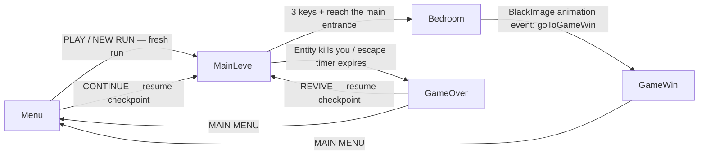

<div align="center">

# LAST BELL

**A first-person mobile horror game set in a school at night.**

Find three keys. Unlock the school, wing by wing. Stay out of sight —
and when the final bell rings, run.


-0A66C2)


</div>

---

| Field | Value |
|---|---|
| **Current release** | `2.0` (bundleVersion) · AndroidBundleVersionCode `20` |
| **Latest artifact** | `Builds/LastBell-0.4-v4.aab` — 39.0 MB · ARM64 · IL2CPP · `jar verified` (**2.0 build pending**) |
| **Artifact SHA-256** | `CA484BC584D52286B62C3DA6B314052741DEECC3F26B98B499796CF159CF6804` |
| **Repository** | <https://github.com/HAMZAPOWERPLAYER/last-bell> |
| **Document owner** | HAMZA POWERPLAYER |
| **Status** | Active development — pre-release, pending end-to-end on-device verification |

**Last Bell** is a mobile-focused derivative of
[High School Horror Android](https://github.com/yurifarion/High-School-Horror-Android-Unity3D) by
**yurifarion** (CC-BY-4.0), reworked with new touch controls, progression gates, an opening and
ending cinematic, lighting, settings and menus. See [Credits & licensing](#credits--licensing).

---

## Table of contents

1. [Overview](#1-overview)
2. [Quick facts](#2-quick-facts)
3. [Gameplay & rules](#3-gameplay--rules)
4. [Controls](#4-controls)
5. [System architecture](#5-system-architecture)
6. [Level design](#6-level-design)
7. [Menus, settings & UX](#7-menus-settings--ux)
8. [Repository layout](#8-repository-layout)
9. [Getting started](#9-getting-started)
10. [Editor tooling](#10-editor-tooling)
11. [Build & release](#11-build--release)
12. [QA & verification](#12-qa--verification)
13. [Troubleshooting & FAQ](#13-troubleshooting--faq)
14. [Privacy & data handling](#14-privacy--data-handling)
15. [Known limitations](#15-known-limitations)
16. [Roadmap](#16-roadmap)
17. [Credits & licensing](#17-credits--licensing)
18. [Contributing](#18-contributing)
19. [Document control](#19-document-control)

---

## 1. Overview

Last Bell is a first-person survival-horror game for Android phones, built in
**Unity 2022.3.62f3 LTS** on the **Built-in Render Pipeline** (URP is intentionally not used —
see [Known limitations](#15-known-limitations)).

The player explores a darkened school, collects **three keys** to unlock the building gate by
gate, optionally uncovers a six-part backstory through collectible **pages**, and escapes before
an entity — which only activates once the first key is taken — corners them. The final act is a
timed escape run back to the main entrance.

**Project highlights**

- Fully touch-native controls (fixed analog stick + drag-to-look), tuned for landscape phones.
- Tile-by-tile progression: two keyed gates split the school into three act spaces.
- Data-driven tuning: the entity's sight, danger meter, teleport cadence and escalation are
  serialized fields, tunable in the scene without code changes.
- A complete, skippable cinematic layer: opening in-engine cutscene plus distinct ending
  sequences for win and death.
- Checkpointed **save & continue**: keys, pages, unlocked gates and the run's exact item
  layout survive death and app restarts; the menu offers `CONTINUE` when a saved run exists.
- Zero runtime networking, no ads, no analytics — settings and run progress live in
  `PlayerPrefs` only.
- 39 MB release bundle (AAB) shipped from a reproducible local release procedure with a signed
  verification record.

---

## 2. Quick facts

| | |
|---|---|
| Engine | Unity **2022.3.62f3 LTS** |
| Render pipeline | **Built-in RP** |
| Package ID | `com.hamzapowerplayer.lastbell` |
| Product name | Last Bell |
| Company | HAMZA POWERPLAYER |
| Version | `2.0` (bundleVersion) · AndroidBundleVersionCode `20` |
| Orientation | Landscape |
| Active build platform | `Android` — release AAB, **IL2CPP / ARM64** |
| Min SDK / Target SDK / Compile SDK | 24 / 36 / 36 |
| Input | Unity Input System **and** legacy Input Manager (`Active Input Handling = Both`) |
| Connectivity | Fully offline — no login, no accounts, no ads, no analytics |
| Signing | Custom keystore `C:/MOBILE-Keys/lastbell.keystore`, alias `lastbell` (outside the repo) |

---

## 3. Gameplay & rules

### Objective

**Primary mission — escape.** Explore the school, find **3 keys**, then reach the main exit
door. The exit prompt only appears once you hold all three. Escaping loads `Bedroom`, whose
final fade animation advances to `GameWin`.

**Collectibles — 6 pages.** Six readable notes are scattered through the level carrying
environmental lore. They are optional to escape but are the game's storytelling. Each page
opens a full-screen viewer; a tap anywhere closes it.

**The entity is inert until you pick up your first key.** Before then nothing stalks you.

### Key progression (acts)

| Key | In-game name | Effect |
|---|---|---|
| 1st | Classroom Key | Entity **awakens**. Objective becomes “unlock the classroom wing”. |
| 2nd | Stairwell Key | Objective becomes “unlock the upper corridor”. |
| 3rd | Main Gate Key | **Escape act begins**: a **30-second** countdown starts and the HUD switches to `RUN! Ns`. |

Two physical doors (`ProgressionGate`) gate progress: the classroom-wing gate requires 1 key,
the upper-corridor gate requires 2. Walking into a gate shows `UNLOCK <GATE>` on the pick button;
pressing it with too few keys answers “Need N more key(s)…”.

### Win, failure and the escape timer

- **Win** — reach the main entrance during the escape act → `Bedroom` → `GameWin`.
- **Death** — if the entity catches you in view for too long, or the **30 s escape timer**
  expires, the game loads `GameOver`.
- Death does **not** clear your progress. `REVIVE` resumes the **last checkpoint** — same keys,
  pages, unlocked gates and item layout — and respawns you at the level start.
- Progress is checkpointed at run start, every key/page pickup and every gate unlock — see
  [Run-state & persistence model](#run-state--persistence-model). Closing and reopening the
  game mid-run and choosing `CONTINUE` resumes the same checkpoint; a fresh run starts only
  via **PLAY / NEW RUN**. Resuming a run that holds all 3 keys starts a fresh 30 s escape
  countdown.

### Placement model

Placement is randomised every run. `GameManager.initSpawns()` finds all **18** `SpawnItem` spots
and rolls them:

- Each uncollected key is assigned to a spawn point tagged with its **progression stage**
  (stage 0 → Classroom Key, stage 1 → Stairwell Key, stage 2 → Main Gate Key), with a logged
  fallback if a stage has no free point.
- The remaining spots become **pages** (shuffled), the rest stay empty. A spot can only hold
  one item.
- The rolled layout is **recorded in the save** as a compact per-spot code (`--` empty, `K0`–
  `K2` key stage, `P0`–`P5` page index, in spawn order). Resuming replays it exactly, so every
  uncollected item stays where it was; items already collected are simply absent.

### The entity — behaviour summary

| Trait | Behaviour |
|---|---|
| Movement | **Never walks.** No NavMesh, no pathfinding — it **teleports** around the player and rotates to face them. |
| Teleport range | Random point within ±30 units of the player, on the player's own floor; at least **8 m** away. |
| Destination choice | Up to **24 bounded re-rolls**; prefers spots outside a 60° view cone, or occluded by level geometry. |
| Sight | One forward ray to the player (budgeted to a 0.12 s cadence) + a flashlight trigger volume (`DetectMonster`). |
| Safe place | While unseen and in no danger it retreats to `SafePlaceSpawn` on a timer. |
| Escalation | Per key collected: teleport interval tightens (floor 3.5 s), face-speed and near-radius grow; the escape act adds a further spike. |

### Danger meter

Not a 0–1 value. It ramps toward `dangerCeiling` (10) over `lifeDuration` (**7 s** in the scene)
while you are both near and in view, and decays when you break line of sight.

- Death at `dangerDeathThreshold` = **6.9** → roughly a **4.83 s reaction window**.
- All of these are serialized fields on the `Monster` component, tunable without code changes.
- The red death overlay's alpha is driven by the meter as visible feedback.

### Flashlight — `Flashlight.cs`

- Toggles with a click sound effect.
- **Infinite battery by default** (`batteryDrainEnabled = false`). A full drain system exists and
  is correct, but is deliberately **off**: the flashlight is the player's only light source and
  there are no battery pickups, so a drain would make the game unwinnable.
- `Addbattery(seconds)` is implemented and re-ignites a dead light, ready for pickups if the
  drain is ever enabled. The battery UI shows a percentage when draining, `--` when unlimited.

---

## 4. Controls

| Action | Input |
|---|---|
| Move | Left thumbstick (fixed, bottom-left). **Analog** — partial deflection is partial speed. |
| Sprint | Push the stick to its outer ring (`FullInput`). |
| Look | **Touch-drag anywhere on the right half of the screen.** Not a joystick — drag delta drives the camera. |
| Flashlight | On-screen button — plays a click SFX. |
| Interact / pick up | On-screen button, appears when in range of a key, page or gate. |
| Pause | HUD button (top-right) or the **Android back button**. |
| Skip cinematic | On-screen **SKIP** button, `Escape`, or `Space` (editor). |

**Look sensitivity** baseline is `0.15° per pixel of drag`. Adjustable in Settings from ×0.4 to ×2.0.

**The Android back button opens the pause menu; it no longer quits the game.** (Removing the
upstream `Application.Quit()` on Escape was a deliberate behavioural change.)

---

## 5. System architecture

### Scene flow



### Key progression flow

```mermaid
flowchart LR
    K0["Start — 0 keys<br/>entity inert"] -->|"pick up Classroom Key"| K1["1 key — entity awake"]
    K1 -->|"unlock classroom wing gate"| G1["wing open<br/>objective: Stairwell Key"]
    G1 -->|"pick up Stairwell Key"| K2["2 keys"]
    K2 -->|"unlock upper corridor gate"| G2["upper corridor open<br/>objective: Main Gate Key"]
    G2 -->|"pick up Main Gate Key"| K3["3 keys — 30 s escape timer"]
    K3 -->|"reach the main entrance"| WIN["Bedroom → GameWin"]
```



### Runtime systems

| Script | Responsibility |
|---|---|
| `Controller.cs` | Player movement + camera. Reads `ControlStick` / `ControlPad`; analog speed; footstep gating; pauses its own input while paused. |
| `Monster.cs` | Entity AI: bounded out-of-view teleport, sight ray, danger meter, threat escalation per key, one-shot death → `GameOver`. |
| `DetectMonster.cs` | Flashlight trigger volume → `isOnFlashLightTrigger`. |
| `Flashlight.cs` | Light toggle, battery (drain implemented, disabled by default), click SFX. |
| `GameManager.cs` | Run lifecycle (`StartNewRun` / `ContinueRun` / resume path), staged key/page placement with save-layout replay, pickup flow, key HUD, gates, mission objectives, escape sequence + timer, save checkpoints. |
| `RunSave.cs` | `PlayerPrefs` save model (2.0): run flag + format version, key count, 6-bit page mask, gate bits and a compact per-spot layout codec; `HasSave` / `Clear` / checkpoint writers. |
| `ProgressionGate.cs` | Keyed door: interaction prompt, `TryOpen`, animated swing (`openAngle`, `openDuration`). |
| `KeyTrigger.cs` / `PageTrigger.cs` | World triggers; carry per-stage key titles/clues and page narratives. |
| `ExitTrigger.cs` | Main-entrance prompt; starts `Bedroom` when 3 keys are held (direct-touch and button paths). |
| `SpawnItem.cs` | Instantiates key/page prefabs at spawn spots; applies stage-appropriate narrative text. |
| `OpeningCutscene.cs` | Skippable in-engine opening: letterbox overlay, camera moves, staged monster reveal, stinger; fully restores state on skip/complete/destroy. |
| `EndingCutscene.cs` | Skippable ending for `GameWin` and `GameOver` (`gameOverEnding` flag): ambience beds, riser, monster reveal/lunge, impact flash, camera shake, final card. |
| `PauseManager.cs` | Pause state: freezes `Time.timeScale`, mutes `AudioListener`, stops monster coroutines, blocks player input; owns Escape/back handling. |
| `PauseMenuUI.cs` / `MainMenuUI.cs` | Code-built menu UI in the LAST BELL text-list style. |
| `LastBellMenuStyle.cs` | Menu presentation: procedural sprites + unscaled-time coroutine animation (shared by both menus). |
| `GameSettings.cs` | Settings values, persistence, graphics tier mapping, look-sensitivity application. |
| `AudioVolumeController.cs` | Master/Ambient/SFX application to every source (no AudioMixer groups required). |
| `AmbientAudioManager.cs` | Random ambient cue scheduler (creaks / distant sounds, 12–35 s cadence). |
| `FlickerLight.cs` / `StairsAmbience.cs` / `MobileControlsLayout.cs` | Lighting flicker, stairwell cue ducking, adaptive control sizing. |
| `MenuAction.cs` | Legacy upstream scene-nav buttons used by the ending scenes; `revive()` now resumes the checkpoint via `GameManager.ContinueRun()` (falling back to a fresh run when no save exists). |
| `Diag.cs` | Dev-only tracing via `[Conditional("UNITY_EDITOR")] / [Conditional("DEVELOPMENT_BUILD")]` — zero cost in release players. |

### Run-state & persistence model

| Key (`PlayerPrefs`) | Meaning |
|---|---|
| `Keys` | Keys collected **in the current run** (0–3). Restored on resume. |
| `RunActive` | `1` while a run is genuinely in progress — lets `MainLevel` tell a deliberate resume from a stale save. |
| `Save.State` / `Save.Version` | `1` when a resumable checkpoint exists; save-format version (`1`). |
| `Save.Keys` / `Save.Pages` | Checkpointed key count and a 6-bit mask of collected pages. |
| `Save.Gates` | Bitmask of unlocked gates: bit 0 classroom wing, bit 1 upper corridor. |
| `Save.Layout` | Compact per-spot layout codes (`--`, `K0`–`K2`, `P0`–`P5`) in spawn order. |
| `opt_lookSensitivity`, `opt_volumeMaster`, `opt_volumeAmbient`, `opt_volumeSfx`, `opt_graphicsTier` | Persistent settings. |

A checkpoint is written at run start, on every key pickup, page pickup and gate unlock — and it
**survives death**. Both `REVIVE` (GameOver) and `CONTINUE` (menu) reload `MainLevel` and restore
the checkpoint; the menu additionally shows the progress it will restore (`CONTINUE (n/3 KEYS)`).
The save is cleared when you **win**, when a **NEW RUN** starts, and by a stale-save guard:
entering `MainLevel` with no checkpoint, or with one but neither a resume request nor an active
run flag, discards it and starts fresh. If the saved layout no longer matches the scene's spawn
spots it is dropped on its own, while keys/pages/gates still resume. See `RunSave.cs`.

### Audio architecture

| Layer | Source |
|---|---|
| Ambient bed | `Ambient_SchoolNight_Bed` — 193 s seamless loop, Vorbis mono q0.45 (~1.1 MB in memory) |
| Random cues | `AmbientAudioManager` — creaks / distant sounds on a 12–35 s random interval |
| Footsteps | Play while **moving and grounded** (they do not loop while standing still) |
| One-shots | Flashlight click, horror scream, escape cue, opening/ending stingers |
| Cinematics | Ending beds — horror ambience loop, background atmosphere loop, trailer riser, impact hit |
| Stairs | 4 trigger volumes duck the ambient bed while you are on the stairwell |

Volume is split **Master / Ambient / SFX**, persisted and applied at runtime by
`AudioVolumeController` (per-source scaling — no AudioMixer groups required).

### Lighting

Floor 1 was originally **completely unlit** (ambient colour only). Fixtures were added:

| Space | Mood |
|---|---|
| Floor 1 corridor | 3 × sickly-green fixtures, **flickering** with dropouts — the tension space |
| Classroom_1_1 | Warm, single steady fixture — the calm room |
| Classroom_1_2 | Cooler, twin fixtures, **one failing tube** — the "wrong" room |
| Restroom | Cold, dim, sterile |
| Floor 2 corridor | Darker and greener than Floor 1, with heavier flicker dropouts |
| Classroom_2_1 | Clinical lab white, 3 steady fixtures — distinct from both Floor 1 classrooms |

`FlickerLight` drives the flicker (Perlin noise + randomised dropouts). All lighting is
**realtime** — nothing is baked (no lightmaps). Floor 2 room lights are range-capped at 10 m to
avoid light bleed and per-pixel cost. Per-scene `LightingSettings` assets exist for `Menu`,
`GameWin` and `GameOver`.

### Cutscenes

- **Opening (`MainLevel`)** — fade in from black, title cards, three camera moves, the entity is
  staged, howls and is stung, then control is handed to the player. Skippable at any point;
  restores camera, monster, pause, canvases, timescale and cursor state.
- **Ending (`GameWin` / `GameOver`)** — letterboxed card sequence over a blacked-out camera with
  a staged monster reveal and (for death) a lunge, impact flash and camera shake. Skippable;
  restores the scene's menu canvas when finished.

---

## 6. Level design

**Floor 1** — `FirstFloorCorridor`, `Classroom_1_1`, `Classroom_1_2`, `Restroom`
(plus `Library`, `Lab`, the shared `Main Structure` shell and `Stair`)

**Floor 2** — `SecondFloorCorridor`, `Classroom_2_1`

**Scenes** (in build order)

| Index | Scene | Purpose |
|---|---|---|
| 0 | `Menu` | Main menu |
| 1 | `MainLevel` | The school — both floors, all gates, cutscene, 18 spawn spots |
| 2 | `Bedroom` | Post-escape scene; its fade animation advances to `GameWin` |
| 3 | `GameWin` | Ending cutscene → win screen |
| 4 | `GameOver` | Ending cutscene → death screen with `REVIVE` / `MAIN MENU` |

---

## 7. Menus, settings & UX

**Main menu** — CONTINUE (only while a saved run exists) · PLAY / NEW RUN · SETTINGS · CREDITS · LICENCES · QUIT

`CONTINUE` appears only when a checkpointed run exists and shows what it will restore, e.g.
`CONTINUE (2/3 KEYS)`; in that case `PLAY` becomes `NEW RUN` (which clears the save and rolls a
fresh layout). The six rows are laid out to stay inside the ±180-unit landscape safe band.

**Pause menu** — RESUME · SETTINGS · CREDITS · MAIN MENU · QUIT
Pausing freezes `Time.timeScale`, mutes audio, stops the entity's coroutines, and blocks player
input so the view cannot drift behind the panel. Resuming re-arms the entity's safe place.

**Style.** Both menus are the LAST BELL text-list style: a wide-spaced thin title top-left with a
subtitle, left-aligned uppercase items with **no boxes or panels**, a translucent slanted
(parallelogram) highlight bar that slides in behind the pressed item, tiled grain and a slow
vignette pulse over a near-black background, and a right-hand art image that fades into darkness
toward the left. All of it lives in **one** reusable component, `LastBellMenuStyle`, animates only
`RectTransform` / `CanvasGroup.alpha` / `Graphic` colour, uses **unscaled time** (so the pause menu
animates while `Time.timeScale = 0`) and generates every sprite procedurally — no new packages and
no new art assets beyond the placeholder below.

**Art slot.** `backdropArt` is a single serialized `Sprite` field on both `MainMenuUI` and
`PauseMenuUI` — drop your own image in to replace the placeholder corridor screenshot
(`Assets/Main/UI/Art/MenuBackdrop_Corridor.png`, captured from this game's own first-floor
corridor). The pause menu renders it at `backdropArtAlpha` (default 0.55) so the frozen world still
hints through.

**Font.** Menu text uses Unity's built-in font unless `displayFont` is set on the menu component.
There is a reserved **TYPE** entry on the Licences screen: any free SIL OFL display font added
later must be credited there.

**Settings** (shared by both menus, single source of truth in `GameSettings`)

| Setting | Range / values |
|---|---|
| Look sensitivity | ×0.4 – ×2.0 around the 0.15°/px baseline |
| Master / Ambient / SFX volume | 0–100 % |
| Graphics | Low / Medium / High |
| Reduce flashing | Normal / Reduced — softens the level's tube flicker and stops the menu title dips |
| Restore defaults | RESET DEFAULTS button on both settings screens |

**Graphics tiers** — this is the low-end safety net:

| Tier | Per-pixel lights | Shadows | Shadow distance |
|---|---|---|---|
| **Low** | **1** | **Disabled** | **10** |
| Medium | 2 | Hard only (low res) | 18 |
| High | 4 | Soft, medium res | 30 |

All settings persist via `PlayerPrefs` and are applied at startup by `GameSettings`.

---

## 8. Repository layout

```text
C:\MOBILE\                          (Unity project root = repository root)
├── Assets/
│   ├── Main/
│   │   ├── Scenes/                 Menu, MainLevel, Bedroom, GameWin, GameOver
│   │   │                           (+ per-scene *.lighting settings assets)
│   │   ├── scripts/                gameplay + systems (see §5)
│   │   ├── Audio/                  ambient bed, footsteps, click, scream,
│   │   │                           escape cue, cinematic beds/stingers
│   │   ├── Animation/Final/        Bedroom Image controller + BlackImage event clip
│   │   ├── Material/               authored materials, incl. Floor2/ texture materials
│   │   ├── Prefab/                 Key, Page, monster + jump-scare prefabs
│   │   ├── Pages/                  six page artworks (jpg)
│   │   └── UI/                     HUD sprites, generated control sprites
│   │       ├── Art/                menu backdrop + LastBellAppIcon (pending assignment)
│   │       └── Generated/          procedurally generated control art
│   ├── Editor/                     tooling menu items (see §10)
│   ├── Plugins/Android/            AndroidManifest.xml.DISABLED (custom manifest kept off)
│   └── ThirdAssets/
│       ├── school/                 school props + building shell (FBX, embedded materials)
│       ├── FloorTile/              floor material set
│       ├── Toon Furniture/, Horror Monster/, lineLight/
│       ├── NeKONTROLLER/           upstream touch-control art + scripts (MIT)
│       └── CC0/                    Poly Haven textures (bricks, wood floor, wood)
├── Packages/
│   ├── manifest.json               Unity Input System, TMP, Timeline, uGUI, …
│   ├── com.bezi.sidekick/          embedded editor-only dev assistant (see §9)
│   └── com.coplaydev.unity-mcp     local MCP bridge (absolute path — see §13)
├── ProjectSettings/                committed; SDK versions, identity, input handling
├── Builds/                         release artifacts + verification records (gitignored)
├── Screenshots/                    menu/pause captures at device resolutions + the CONTINUE menu
├── CLOUD_BUILD.md                  cloud build guide (game-ci / Unity Build Automation)
└── README.md                       this document
```

**Notable data conventions**

- Texture compression: albedo **ASTC 6×6**, normal maps **ASTC 4×4**, data maps
  (roughness / AO / displacement) **ASTC 6×6 at ≤512 px**, `wrapMode = Repeat` for tiling.
- Page artwork `friday.jpg` … `wednesday.jpg` matches the six narrative page entries in
  `SpawnItem.cs`.

---

## 9. Getting started

### Requirements

| Requirement | Detail |
|---|---|
| Unity | **2022.3.62f3 LTS** (pin exactly — a different patch may silently upgrade the project) |
| Unity modules | Android Build Support (SDK 34.0.0, NDK r23b) for device builds |
| JDK | JDK 11 — if the editor cannot find one, point *Preferences ▸ External Tools ▸ JDK* at a JDK 11 install (the module's bundled `OpenJDK` folder is not present on this machine) |
| Packages | `com.unity.inputsystem` and the rest of `Packages/manifest.json` (auto-resolved) |

### Opening the project

1. Clone the repository and open the folder in Unity Hub with **2022.3.62f3**.
2. Let the package manager resolve; first import rebuilds `Library/` (~10–20 min).
3. Open `Assets/Main/Scenes/Menu.unity` to start from the menu, or `MainLevel.unity` to jump
   straight into gameplay. Press Play.

> **Note — local-only package references.** `Packages/manifest.json` contains one `file:`
> dependency that points at a development-tool location on this machine
> (`com.coplaydev.unity-mcp` → `C:/unity-mcp-main/MCPForUnity`), and `Packages/` also carries
> the embedded `com.bezi.sidekick` dev-assistant package. Both are editor tooling, not game
> code; see [Troubleshooting](#13-troubleshooting--faq) before using a machine that lacks
> them, and before any cloud build.

### Diagnostics

Development tracing goes through `Diag.Log(...)`, which compiles out unless `UNITY_EDITOR` or
`DEVELOPMENT_BUILD` is defined — release players pay nothing and log nothing. When testing in
the editor, filter the console by `[DIAG]` to see pickup, gate, pause and cutscene flow.

---

## 10. Editor tooling

All tooling ships as editor menu items (not in builds). They are safe to re-run and verify or
repair scene wiring.

| Menu | Items |
|---|---|
| `Tools/NeKONTROLLER` | Setup Touch Controls · Verify Touch Controls · Runtime Smoke Test · Capture Game View Screenshot · Regenerate Flashlight Click SFX · Diagnose Input Handling |
| `Tools/Floor1` | Audit · Apply Texture Import Settings · Build Lighting · Wire Audio Hooks · Runtime Monster Test · Run Whole Pass |
| `Tools/Floor2` | Audit · Texture Assign Prep · Apply Texture Import Settings · Build Lighting · Build Stairs Cue · Check Content Placement · Configure/Assign CC0 Textures · Assign Wood Textures · Fix/Revert Floor Texture · Run Whole Pass |
| `Tools/Part7` | Setup Pause Manager · Setup Audio Mixer · Add Ambient + SFX Groups · Report · Runtime Pause Test · Runtime Pause Channel Test |
| `Tools/Part8` | Set Package Identity |
| `Tools/Part9` | Game View Size presets (2340×1080 / 1920×1080 / 1280×720 / 720×1280) · Capture Menu Backdrop · Assign Menu Art In Active Scene · Runtime Menu Animation Test |
| `Tools/Part10` | Verify Save Round-Trip (edit mode) · Runtime Save Continue Test (while playing — drives real scene reloads through the entire save/continue flow) |
| `Tools/Audio` | Compress Ambient Bed |

---

## 11. Build & release

### Build configuration (Player Settings)

| Setting | Value |
|---|---|
| Scripting backend | IL2CPP |
| Target architecture | ARM64 only |
| Build type | **Build App Bundle (Google Play)**, Release |
| Min SDK | 24 |
| Target SDK | 36 |
| Signing | Custom keystore `C:/MOBILE-Keys/lastbell.keystore`, alias `lastbell` |

### Local release procedure

1. **Bump the version** — `bundleVersion` (`2.0`) and `AndroidBundleVersionCode` (`20`) in
   `ProjectSettings/ProjectSettings.asset`. Increment the code for every upload.
2. **Build the AAB** from Unity (Build Settings ▸ Build App Bundle ticked), supplying the
   keystore password in Player Settings ▸ Publishing. The password is **never committed**; it
   lives only in the editor session / `Library/` (gitignored).
3. **Verify** the bundle and record the evidence next to it (see the record format used by
   `Builds/aab_verification_0.4-v4.txt`):
   - `jarsigner -verify -verbose -certs` → expect `jar verified.`
   - SHA-256 of the AAB and of the IL2CPP symbols zip.
   - Identity read from the bundle's own `base/manifest/AndroidManifest.xml`
     (package / versionName / versionCode / SDK levels).
   - Native ABIs packaged (`arm64-v8a` only) and scenes baked (`level0..level4`).
4. **Archive** the AAB + symbols zip in `Builds/` (gitignored — keep them backed up elsewhere,
   e.g. Play Console or artifact storage).

### Release history

| Artifact | Version (code) | Size | Notes |
|---|---|---|---|
| `Builds/LastBell-0.4-v4.aab` | 0.4 (4) | 39.0 MB | Current — `jar verified`, SHA-256 recorded, symbols archived |
| `Builds/LastBell-API36.aab` | 0.2 (3) | — | targetSdk 36 experiment |
| `Builds/LastBell-0.2-v2.aab` | 0.2 (2) | 38 MB | First Play-ready bundle |
| `Builds/LastBell-0.1-v1-IL2CPP.symbols.zip` | 0.1 (1) | — | Symbols only (early IL2CPP pipeline test) |

### CI/CD

The intended pipeline is documented end-to-end in [CLOUD_BUILD.md](CLOUD_BUILD.md)
(GitHub Actions + game-ci, or Unity Build Automation). A workflow is **not yet committed**
(no `.github/` directory). Minimum required repository secrets:

| Secret | Value |
|---|---|
| `UNITY_LICENSE` / `UNITY_EMAIL` / `UNITY_PASSWORD` | Unity activation (Personal: `.ulf` file) |
| `ANDROID_KEYSTORE_BASE64` | base64 of `lastbell.keystore` |
| `ANDROID_KEYSTORE_PASS`, `ANDROID_KEYALIAS` (`lastbell`), `ANDROID_KEYALIAS_PASS` | Signing |

> **Before wiring CI:** remove or neutralize the local package references:
> `com.coplaydev.unity-mcp` is a `file:` entry pointing at an absolute `C:/…` path no runner
> has, and `com.bezi.sidekick` is an embedded editor tool living in `Packages/`.
> CI otherwise fails at package resolution. See [Troubleshooting](#13-troubleshooting--faq).

### Play Store release checklist

- [ ] Version code incremented.
- [ ] Release AAB built, `jarsigner` verified, hash recorded.
- [ ] Symbols zip archived for crash symbolication.
- [x] **App icon assigned in Player Settings** (6 slots, 2.0 — visual check on a device still pending).
- [ ] Store listing / screenshots refreshed (see `Screenshots/`).
- [ ] On-device acceptance pass (§12) on a physical device.

---

## 12. QA & verification

### In-editor verification (tooling)

| Check | Tool |
|---|---|
| Touch UI present and wired | `Tools/NeKONTROLLER ▸ Verify Touch Controls` |
| Input handling diagnosed | `Tools/NeKONTROLLER ▸ Diagnose Input Handling` |
| Pause round-trip | `Tools/Part7 ▸ Runtime Pause Test` |
| Monster runtime behaviour | `Tools/Floor1 ▸ Runtime Monster Test` |
| Menu animation while paused | `Tools/Part9 ▸ Runtime Menu Animation Test` |
| Save round-trip (edit mode) | `Tools/Part10 ▸ Verify Save Round-Trip` |
| Save/continue runtime flow | `Tools/Part10 ▸ Runtime Save Continue Test` |
| Level audit (hierarchy, missing refs) | `Tools/Floor1 ▸ Audit`, `Tools/Floor2 ▸ Audit` |
| Content placement | `Tools/Floor2 ▸ Check Content Placement` |

### On-device acceptance checklist

1. **It launches** and the main menu appears with all buttons visible (this is the first real
   test of the ±180 landscape layout).
2. **Buttons are readable** — single horizontal lines, no vertical letter stacking.
3. **Touch controls work** — left stick moves, right-half drag looks around.
4. **Pause** via the HUD button and the Android back button; Resume returns cleanly.
5. **Settings persist** — change the graphics tier, force-close the app, reopen, confirm it stuck.
6. **Save & continue** — collect a key or two, force-close the app, reopen: the menu shows
   `CONTINUE (n/3 KEYS)` and resuming restores the keys, open gates and every remaining item's
   position. Dying and pressing `REVIVE` restores the same checkpoint; finishing the game clears
   it (the next launch shows `PLAY`).
7. **Opening cutscene** plays, is skippable, and hands over control without camera drift.
8. **Full run** — pick up a key (entity activates), unlock both gates, collect 3 keys, survive
   the 30 s escape run, reach the entrance, watch the ending, return to the menu.
   *Nobody has completed a full run end to end on device yet — this is the outstanding
   verification.*
9. **Frame rate** on the target device, especially on Floor 2 which has the most realtime lights.

### Performance & budget notes

- Release config strips engine code and uses medium IL2CPP optimization; bundle is ARM64-only.
- Graphics tiers exist specifically as the low-end safety net (Low = 1 per-pixel light).
- Total new audio is well under the 15–20 MB slice; imported CC0 textures occupy roughly
  3.8 MB compressed (58 MB uncompressed) against a 250 MB overall budget.
- 7 pre-existing build warnings are catalogued in the 0.4-v4 verification record (input
  handling Both, mobile pixel-light count, dual EventSystem modules).

---

## 13. Troubleshooting & FAQ

**The editor cannot find a JDK / Android build fails immediately.**
Point *Preferences ▸ External Tools ▸ JDK* at a JDK 11 install. The Android module's bundled
`OpenJDK` folder is not present on this machine.

**Cloud/CI build fails at package resolution.**
`Packages/manifest.json` references `com.coplaydev.unity-mcp` by an absolute local path
(`file:C:/unity-mcp-main/MCPForUnity`), and `Packages/` also contains the embedded
`com.bezi.sidekick` editor package. For CI, remove both entries from `manifest.json` (and the
matching `packages-lock.json` entries) or replace them with fetchable sources. They are
development tooling — the game itself does not reference them.

**Unity warns “Active Input Handling is set to Both, this is unsupported on Android”.**
Intentional. The project must support both the Input System (EnhancedTouch reading) and legacy
`Input` (back button, editor testing). Accepted and documented.

**The pause menu's BACK/Escape behaves oddly with a sub-panel open.**
Pre-existing behaviour: Escape with a sub-panel open closes the panel *and* unpauses (the pause
state owns Escape). Use the on-screen **BACK** button to return to the pause list without
resuming. On the main menu, Escape closes the open panel and stays on the menu.

**Launching directly into `MainLevel` resumes a previous run (or starts fresh unexpectedly).**
By design: `MainLevel` resumes when a checkpoint exists and either a `CONTINUE`/`REVIVE`
request or the `RunActive` flag is present; otherwise any stale save is discarded and a fresh
run begins. Use `GameManager.StartNewRun()` (as the menu's `NEW RUN` does) from custom entry
points.

**Console spams “Creating missing EventSystem component for InputSystemUIInputModule”.**
Known cosmetic issue: each scene's EventSystem carries both an Input System and a legacy input
module. Deleting the legacy `StandaloneInputModule` from the 5 scenes would silence it.

**Where is the save file?**
There isn't a file. The save/continue checkpoint lives in `PlayerPrefs` (`Save.*`: key count,
collected-page mask, unlocked gates, item layout). It survives death and app restarts, is
cleared automatically when the run is won or a `NEW RUN` starts, and is deleted with the app's
data. `Tools/Part10 ▸ Verify Save Round-Trip` prints exactly what is stored.

---

## 14. Privacy & data handling

Last Bell is **fully offline**:

- No login, no accounts, no user profiles.
- No runtime network requests of any kind.
- No ads, no ad SDKs.
- No analytics or telemetry.
- All settings and progress are stored locally on the device via `PlayerPrefs`
  (`opt_*`, `Keys`, `RunActive`, `Save.*`) and deleted with the app's data.

**Repository hygiene:** the signing keystore lives outside the repository
(`C:/MOBILE-Keys/`), and its password is never committed to any tracked file or CI secret in
plaintext. Build artifacts and symbols (`Builds/`) are gitignored. The only URL in the shipped
codebase belongs to the upstream project's legacy privacy screen, which sits on the **disabled**
base menu canvas and is not reachable from the shipped UI.

---

## 15. Known limitations

- **The save is `PlayerPrefs`-only** (no file, no cloud, single slot). Resuming respawns you at
  the level start rather than where you died, and if the saved layout no longer matches the
  scene's spawn spots it is dropped while counters alone resume.
- **URP is not used.** The project runs on the Built-in Render Pipeline. URP was never installed
  and could not be added, so all lighting is Built-in (flicker, realtime fixtures, no
  post-processing).
- **Nothing is baked.** All lighting is realtime; there are no lightmaps.
- **"High" graphics currently matches "Medium"** (4 per-pixel lights, soft shadows). Only Low
  differs.
- **Settings panel layout code is duplicated** between `MainMenuUI` and `PauseMenuUI`. Behaviour
  is single-sourced in `GameSettings`; only the widget construction repeats.
- **App icon**: `Assets/Main/UI/Art/LastBellAppIcon.jpg` is assigned to all 6 Android icon
  slots as of 2.0 (read/write enabled + uncompressed). The previously shipped AABs still carry
  the Unity default icons; the next build picks the real one up. Adaptive-icon variants are not
  authored (the launcher masks the square source).
- **The base project's original menu canvas** still exists in the `Menu` scene but is disabled at
  runtime, so its `MenuAction` scripts keep running without drawing.
- Several Floor 2 surfaces remain untextured (flat colour) — bricks cover the walls, wood covers
  furniture and floor.
- **Local package references** (the MCP bridge `file:` entry + the embedded Bezi Sidekick
  folder) must be removed before cloud builds — see §13.

---

## 16. Roadmap

| Priority | Item |
|---|---|
| P0 | Complete the first **end-to-end on-device run** (spawn → 3 keys → gates → escape → ending). |
| P0 | Rebuild the **signed 2.0 AAB** (app icon now assigned; verify the INTERNET permission is gone — see `RELEASE_CHECKLIST.md`). |
| P1 | Neutralize local `file:` packages and commit the **CI workflow** (`.github/workflows/android.yml` per CLOUD_BUILD.md). |
| P1 | Delete legacy `StandaloneInputModule` from the 5 scenes to silence the EventSystem warning. |
| P2 | **Optional:** resume spawn points — remember roughly where the player was instead of the level start. |
| P2 | Texturing pass for remaining Floor 2 flat-colour surfaces. |
| P2 | Optional: enable flashlight battery drain once battery pickups (`Addbattery`) are placed. |
| P3 | De-duplicate settings-panel construction between the two menu UIs. |
| P3 | Accessibility pass — **reduced-flashing option shipped in 2.0**; text scaling still open. |

---

## 17. Credits & licensing

**Base project** — *High School Horror Android* by **yurifarion**
<https://github.com/yurifarion/High-School-Horror-Android-Unity3D>
Licensed **CC-BY-4.0** — attribution required. See `CC-BY-4.0` / `License.txt`.

**Touch controls** — **NeKONTROLLER** by **NeKoRoSYS**
<https://github.com/NeKoRoSYS/NeKONTROLLER>
Licensed **MIT**. Attribution not legally required but given as good practice.

**Additional art / audio** — third-party CC0 and CC-BY assets are credited in-game on the
Licences screen, including the cinematic audio beds sourced from the Freesound community
(uploads by `freesound_community`, `simplesound`, `universfield`).

**Mobile port, additional content and systems** — **HAMZA POWERPLAYER**

---

## 18. Contributing

- **Issues** — report bugs and suggestions at
  <https://github.com/HAMZAPOWERPLAYER/last-bell/issues>.
- **Branches** — work on a feature branch, keep `main` release-ready.
- **Code style** — match the existing file's conventions (older files use tabs, newer systems
  use 4-space indentation); document public behaviour with XML doc comments; route dev tracing
  through `Diag.Log`, never raw `Debug.Log`, in gameplay code.
- **Scene changes** — use the `Tools/*` menu items where possible so wiring stays reproducible;
  avoid hand-editing scene YAML.
- **Verification** — every PR that touches gameplay should state which §12 checks were run.

---

## 19. Document control

| | |
|---|---|
| Owner | HAMZA POWERPLAYER |
| Status | Active — 2.0 (Save & Continue) |
| Last updated | 2026-10-16 |
| Review cadence | On every release and whenever scene wiring or build config changes |
| Sources of truth | This README for architecture/flow; `CLOUD_BUILD.md` for CI; `Builds/aab_verification_*.txt` for artifact provenance |
